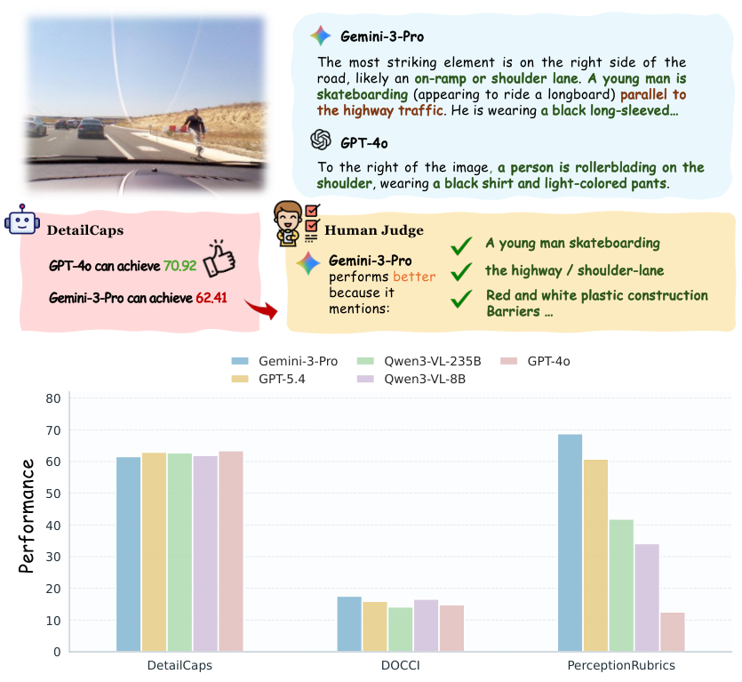
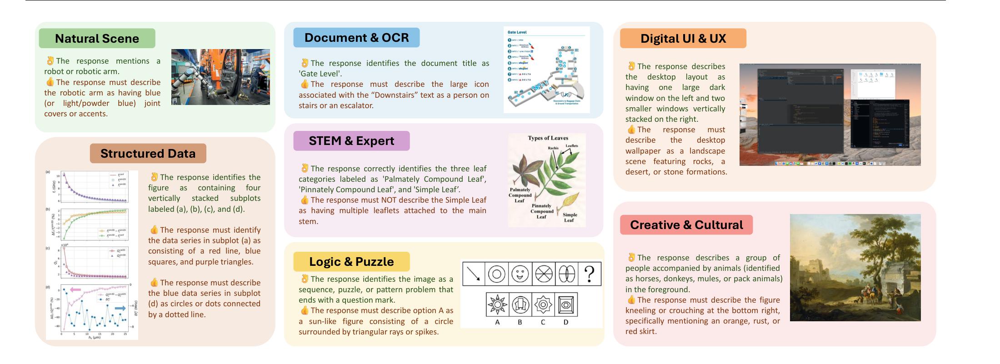

<h1 align="center">PerceptionRubrics:<br>Calibrating Multimodal Evaluation to Human Perception</h1>

> This repository provides the evaluation code and data for **"PerceptionRubrics: Calibrating Multimodal Evaluation to Human Perception"** (ICML 2026). We propose a rubric-based evaluation framework that audits multimodal model captions through atomic, instance-specific rubrics — decomposed into **Must-Right** (essential facts) and **Easy-Wrong** (common hallucination traps) — with a gated scoring mechanism aligned to human perceptual judgments.

<p align="center">
  <a href="https://arxiv.org/abs/2606.28322"></a>
  <a href="https://weiyana.github.io/PerceptionRubrics/"></a>
  <a href="https://huggingface.co/datasets/M1chaelPeng/PerceptionRubrics"></a>
  <a href="LICENSE"></a>
</p>

<p align="center">
  <b>Yana Wei<sup>*1</sup>, Hongbo Peng<sup>*2</sup>, Yanlin Lai<sup>*3</sup>, Liang Zhao<sup>2</sup>, Kangheng Lin<sup>2</sup>, En Yu<sup>2</sup>, Keyu Lv<sup>2</sup>, Han Zhou<sup>2</sup>,<br>
  Yin Tang<sup>4</sup>, Haodong Li<sup>2</sup>, Mitt Huang<sup>2</sup>, Hangyu Guo<sup>2</sup>, Jianjian Sun<sup>2</sup>, Zheng Ge<sup>2</sup>, Xiangyu Zhang<sup>2</sup>, Daxin Jiang<sup>2</sup>, Vishal M. Patel<sup>†1</sup></b><br>
  <sup>1</sup>Johns Hopkins University &nbsp; <sup>2</sup>StepFun &nbsp; <sup>3</sup>Tsinghua University &nbsp; <sup>4</sup>Independent<br>
  <sub><sup>*</sup>Core Contribution &nbsp; <sup>†</sup>Corresponding Author</sub>
</p>

---

## 📖 Overview

Current perception benchmarks suffer from an evaluation paradox: leaderboards are increasingly saturated, yet models remain perceptually brittle in real-world use. We introduce **PerceptionRubrics**, a rubric-based evaluation framework that shifts assessment from holistic semantic matching to rigorous atomic auditing. It pairs 1,038 information-dense images with over 10,000 instance-specific rubrics (4,053 Must-Right + 6,665 Easy-Wrong), derived from Golden Captions constructed through a novel *Circular Peer-Review* consensus pipeline and distilled into a dual-stream system of **Must-Right** (essential facts) and **Easy-Wrong** (fine-grained details) rubrics.

Crucially, PerceptionRubrics implements a **Gated Scoring** mechanism: unlike linear averages, failure on mandatory visual facts triggers sharp binary penalties. Extensive evaluation yields three insights:

1. **The Reliability Gap.** Models often verify fragmented elements correctly yet fail strict conjunctive constraints, exposing brittleness in dense domains such as GUIs.
2. **Open-Closed Stratification.** Contrary to reasoning trends, a persistent ~8% perception deficit separates the open-source frontier from proprietary leaders.
3. **Human-Aligned Rigor.** Our gated metrics substantially out-align conventional benchmarks with human preference, validating that strict perceptual fidelity is a prerequisite for reliable generation.

<p align="center">
  
</p>
<p align="center"><b>Figure 1.</b> (Top) Performance Comparison on Representative Image Captioning Benchmarks.<br>(Bottom) Current Metrics are Typically Uncalibrated in Fine-grained Failure Modes.</p>

---

## 💡 Key Findings

| | Finding | Detail |
|:--:|:--------|:-------|
| 🔗 | **The Reliability Gap** | Models often verify fragmented elements correctly yet fail strict conjunctive constraints, exposing brittleness in dense domains. |
| 🏛️ | **Open-Closed Stratification** | A persistent **~8% perception deficit** between open-source and proprietary frontiers, contrary to reasoning convergence trends. |
| 👁️ | **Human-Aligned Rigor** | Our gated metrics substantially out-align conventional benchmarks (e.g., DOCCI), validating that strict perceptual fidelity is the prerequisite for reliable generation. |

---

## 📊 Benchmark Details

The benchmark spans **7 diverse categories** covering the full spectrum of multimodal capabilities:

<p align="center">

| Domain | Description |
|:------:|:-----------|
| 🌄 Natural Scene | Complex real-world environments |
| 📄 Document & OCR | Text-dense documents, forms, and handwritten content |
| 🖥️ Digital UI & UX | Web pages, mobile UIs, and dashboards |
| 📈 Structured Data | Charts, plots, and tables |
| 🔬 STEM & Expert | Scientific diagrams, geometric figures, and medical imaging |
| 🧩 Logic & Puzzle | Visual riddles and spatial reasoning tasks |
| 🎨 Creative & Cultural | Artworks, cultural artifacts, and design concepts |

</p>

<p align="center">
  
</p>
<p align="center"><b>Figure 2.</b> Rubric Demonstration of PerceptionRubrics. Representative examples are selected for each task,<br>highlighting "Must Right" (essential features) and "Easy Wrong" pitfalls (common hallucinations).</p>

---

## 🏆 Leaderboard

Top-performing models on PerceptionRubrics (Overall Accuracy, %):

<p align="center">

| Rank | Model | Overall |
|:----:|:------|:-------:|
| 🥇 | Seed-2.0-Lite | **70.07** |
| 🥈 | Gemini-3.5-Flash | 69.88 |
| 🥉 | Gemini-3.1-Pro | 69.02 |

</p>

> For full results across all models and 7 domains, see the [project page](https://weiyana.github.io/PerceptionRubrics/).

---

## 🚀 Quick Start

### Installation

```bash
git clone https://github.com/M1chaelPeng/PerceptionRubrics.git
cd PerceptionRubrics
conda create -n perceptionrubric python=3.11 -y
conda activate perceptionrubric
pip install ".[examples]"
```

### One-Command Evaluation

Run the full pipeline (predict + judge) with a single script:

> **Judge Model:** To reproduce the scores reported in the paper, we recommend using `gpt-oss-120b` with `reasoning_effort=medium/high` as the judge model.

```bash
export OPENAI_API_KEY=sk-...
export OPENAI_BASE_URL=https://api.openai.com/v1
export PREDICT_MODEL=gpt-4o
export JUDGE_MODEL=gpt-4o

bash scripts/run_eval.sh
```

### Reproduce Paper Results

Key hyperparameters used in the paper:

| Stage | Parameter | Value |
|:------|:----------|:------|
| Predict | `max_tokens` | 32768 |
| Predict | `temperature` | 1.0 |
| Predict | `top_p` | 1 |
| Predict | `reasoning_effort` | high |
| Judge | `model` | gpt-oss-120b |
| Judge | `max_tokens` | 32768 |
| Judge | `temperature` | 0 |
| Judge | `reasoning_effort` | medium |

All parameters can be overridden via environment variables:

```bash
PREDICT_MODEL=your-model JUDGE_MODEL=gpt-oss-120b WORKERS=16 bash scripts/run_eval.sh
```

<details>
<summary><b>Optional environment variables</b></summary>

| Variable | Description | Default |
|:---------|:-----------|:--------|
| `JUDGE_API_KEY` | API key for the judge model | same as `OPENAI_API_KEY` |
| `JUDGE_BASE_URL` | Base URL for the judge model API | same as `OPENAI_BASE_URL` |
| `DATASET` | HF dataset repo id or local path | `M1chaelPeng/PerceptionRubrics` |
| `SPLIT` | Dataset split | `test` |
| `OUTPUT_DIR` | Output directory | `outputs` |
| `LIMIT` | Evaluate only first N samples | all |

</details>

### Step-by-Step

You can also run each step separately:

**Step 1 — Predict:** Caption every image with your VLM:

```bash
python scripts/predict.py \
  --dataset M1chaelPeng/PerceptionRubrics \
  --split test \
  --output data/predictions.jsonl
```

**Step 2 — Judge:** Score predictions against rubrics:

```bash
python scripts/judge.py \
  --dataset M1chaelPeng/PerceptionRubrics \
  --split test \
  --predictions data/predictions.jsonl \
  --output outputs/results.jsonl
```

<details>
<summary><b>Output summary example</b></summary>

```json
{
  "count": 1038,
  "failures": 0,
  "average_score": 0.4200,
  "mr_pass_rate": 0.5500,
  "ew_average": 0.7600,
  "domain_scores": {
    "Natural Scene": {"count": 148, "average_score": 0.45, "mr_pass_rate": 0.58, "ew_average": 0.78},
    "Document/OCR": {"count": 149, "average_score": 0.40, "mr_pass_rate": 0.52, "ew_average": 0.74},
    "..."
  },
  "output": "outputs/results.jsonl"
}
```

</details>

> `average_score` is the benchmark number to report.

---

## 📝 Citation

If you find this work useful, please cite our paper:

```bibtex
@article{wei2026perceptionrubrics,
  title={PerceptionRubrics: Calibrating Multimodal Evaluation to Human Perception},
  author={Wei, Yana and Peng, Hongbo and Lai, Yanlin and Zhao, Liang and Lin, Kangheng and Yu, En and Lv, Keyu and Zhou, Han and Tang, Yin and Li, Haodong and Huang, Mitt and Guo, Hangyu and Sun, Jianjian and Ge, Zheng and Zhang, Xiangyu and Jiang, Daxin and Patel, Vishal M.},
  journal={arXiv preprint arXiv:2606.28322},
  year={2026}
}
```

## 📜 License

Released under the [Apache License 2.0](LICENSE).
